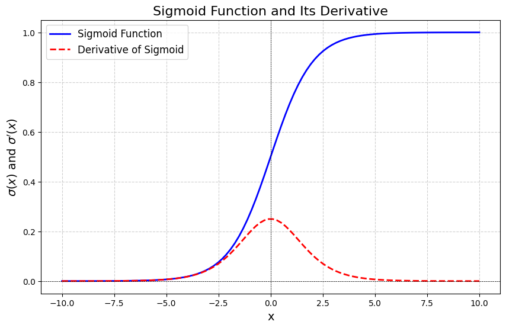
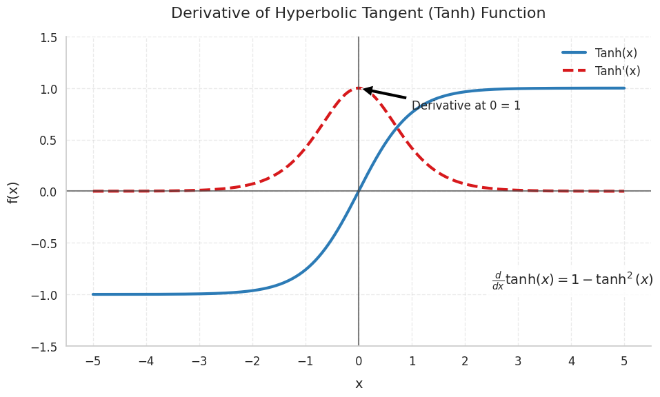
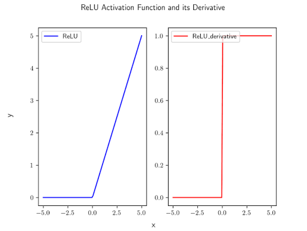
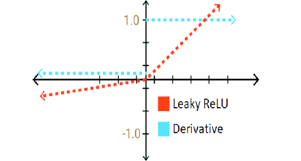
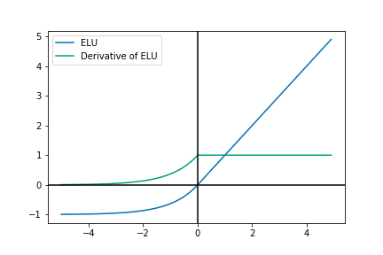

# Comprehensive Guide to Activation Functions in Neural Networks

Activation functions introduce non-linearities into neural networks, enabling them to learn complex decision boundaries and approximate non-linear functions. Without non-linear activation functions, a multi-layer neural network collapses into a single linear transformation, regardless of its depth.

## 1. Sigmoid Activation Function

The Sigmoid function maps any real-valued input to the open interval $(0, 1)$, making it naturally suited for modeling probabilities and binary classification outputs.

### Mathematical Formulation

$$
\sigma(x) = \frac{1}{1 + e^{-x}}
$$

### Derivative

$$
\sigma'(x) = \sigma(x)(1 - \sigma(x))
$$

### Visual Graph

### Key Properties & Characteristics

* **Smooth & Differentiable:** Allows gradient computation via backpropagation across its domain.

* **Monotonically Increasing:** Ensures consistent directional gradient updates.

* **Bounded Output Range:** Output is restricted between $(0, 1)$.

* **Not Zero-Centered:** All output activations are strictly positive ($\sigma(x) > 0$). Consequently, inputs to the subsequent layer are non-centered. This introduces a "zig-zagging" gradient behavior during backpropagation, making optimization less efficient because updates tend to be less balanced.

* **Vanishing Gradient / Saturation Problem:** For very large positive ($x \to \infty$) or negative ($x \to -\infty$) inputs, the slope of the function approaches zero ($\sigma'(x) \to 0$). In these saturated regions, local gradients become extremely small, impeding weight updates in early network layers.

## 2. Tanh (Hyperbolic Tangent) Activation Function

The Tanh function addresses the zero-centered limitation of the Sigmoid function while preserving its smooth, differentiable properties.

> **Key Intuition:** *Can we keep the smooth, differentiable nature of sigmoid while making the activations zero-centered?* Yes—tanh is essentially a scaled and shifted version of the sigmoid function: $\tanh(x) = 2\sigma(2x) - 1$.

### Mathematical Formulation

$$
\tanh(x) = \frac{e^x - e^{-x}}{e^x + e^{-x}}
$$

### Asymptotic Behavior

* As $x \to +\infty$, $\tanh(x) \to +1$

* As $x \to -\infty$, $\tanh(x) \to -1$

### Derivative

$$
\tanh'(x) = 1 - \tanh^2(x)
$$

### Visual Graph

### Key Properties & Characteristics

* **Smooth & Differentiable:** Continuous across its domain.

* **Monotonically Increasing:** Preserves input relative order.

* **Zero-Centered Output:** Output is bounded in $(-1, 1)$. Zero-centered activation keeps the inputs to the next layer more balanced around zero, leading to more stable and efficient gradient optimization compared to Sigmoid.

* **Saturation / Vanishing Gradients:** Like Sigmoid, for large positive or negative inputs, $\tanh(x)$ saturates at $\pm 1$, causing its derivative $\tanh'(x)$ to approach $0$ and triggering vanishing gradients.

## 3. ReLU (Rectified Linear Unit)

Although Sigmoid and Tanh introduce non-linearity, both suffer from saturation. As the input becomes very large (positive or negative), their derivatives approach zero, causing the vanishing gradient problem.

### Mathematical Formulation

$$
\text{ReLU}(x) = \max(0, x) = \begin{cases} x & \text{if } x > 0 \\ 0 & \text{if } x \le 0 \end{cases}
$$

### Derivative

$$
\text{ReLU}'(x) = \begin{cases} 1 & \text{if } x > 0 \\ 0 & \text{if } x < 0 \end{cases}
$$

> **Note on** $x = 0$**:** At $x = 0$, the derivative is technically undefined, but in practice deep learning frameworks simply define it as $0$ (or sometimes $1$). This has negligible impact on training because the probability of a continuous input being exactly zero is essentially zero.

### Visual Graph

### Key Properties & Characteristics

* **Simple and Computationally Efficient:** Requires only basic thresholding without exponential math.

* **Non-Saturating for Positive Inputs:** Unlike sigmoid or tanh, the gradient does not shrink in the positive region ($x > 0$).

* **Sparse Activations:** For negative inputs, the activations will be zero. This sparsity often improves computational efficiency and can act as a mild form of regularization.

* **Piecewise Linear:** Simple linear behavior per section, making optimization easier for gradient-descent algorithms.

* **Dying ReLU Problem:** Suppose a neuron consistently receives negative pre-activations, there will be no gradient update. Its output remains $0$ and its gradient becomes $0$, leaving the neuron permanently inactive ("dead").

## 4. Leaky ReLU & Parametric ReLU (PReLU)

> **Key Intuition:** *Can we keep the simplicity of ReLU while allowing a small gradient for negative inputs?*

To prevent the dying ReLU problem, Leaky ReLU allows a small non-zero gradient for negative inputs.

### Mathematical Formulation

$$
\text{Leaky ReLU}(x) = \max(\alpha x, x) = \begin{cases} x & \text{if } x > 0 \\ \alpha x & \text{if } x \le 0 \end{cases}
$$

*(where* $\alpha$ *is a small positive constant, typically* $\alpha = 0.01$*)*

### Derivative

$$
\text{Leaky ReLU}'(x) = \begin{cases} 1 & \text{if } x > 0 \\ \alpha & \text{if } x < 0 \end{cases}
$$

### Visual Graph

### Variant: Parametric ReLU (PReLU)

You may also come across **PReLU (Parametric ReLU)**, where the negative slope $\alpha$ is learned during training via backpropagation instead of being fixed:

$$
\text{PReLU}(x) = \max(\alpha x, x)
$$

### Key Properties & Characteristics

* **Prevents Dying Neurons:** Since the gradient for negative inputs is $\alpha > 0$, negative pre-activations continue to receive updates.

* **Maintains Computational Speed:** Near-zero runtime overhead compared to standard ReLU.

## 5. ELU (Exponential Linear Unit)

Researchers observed that allowing smooth negative activations could improve optimization by keeping the activations closer to zero.

### Mathematical Formulation

$$
\text{ELU}(x) = \begin{cases} x & \text{if } x > 0 \\ \alpha(e^x - 1) & \text{if } x \le 0 \end{cases}
$$

*(where* $\alpha > 0$*, typically set to* $\alpha = 1.0$*)*

### Asymptotic Behavior

As $x \to -\infty$, $\text{ELU}(x) \to -\alpha$.

### Derivative

$$
\text{ELU}'(x) = \begin{cases} 1 & \text{if } x > 0 \\ \text{ELU}(x) + \alpha = \alpha e^x & \text{if } x \le 0 \end{cases}
$$

### Visual Graph

### Key Properties & Characteristics

* **Smooth Transitions:** Unlike ReLU’s sharp corner, ELU changes smoothly around zero.

* **Negative Activation Saturation:** Saturates to $-\alpha$ for large negative inputs, providing noise robustness.

* **Computationally Expensive:** ELU is computationally expensive because of the exponential operation ($e^x$).

## 6. Modern Transformer Activations: GELU & Swish / SiLU

While ReLU and Leaky ReLU work well in convolutional networks and early feed-forward layers, state-of-the-art Transformer architectures (e.g., BERT, GPT-3, GPT-4, LLaMA, Mistral, PaLM) rely on **GELU** and **Swish / SiLU**.

These functions replace rigid deterministic thresholding with **probabilistic masking** and **self-gating mechanisms**.

### 6.1. GELU (Gaussian Error Linear Unit)

#### Core Intuition & Concept

Standard ReLU multiplies an input $x$ by a deterministic binary indicator $\mathbb{I}(x > 0)$ (either $0$ or $1$). In contrast, GELU merges deterministic activation with **stochastic regularization (Dropout)**.

GELU scales an input $x$ by the probability that a standard Gaussian distribution $\mathcal{N}(0, 1)$ is less than or equal to $x$. Inputs are weighted according to how much higher they are compared to typical noise.

#### Probabilistic & Mathematical Formulation

$$
\text{GELU}(x) = x \cdot \Phi(x) = x \cdot P(X \le x), \quad \text{where } X \sim \mathcal{N}(0, 1)
$$

Here, $\Phi(x)$ is the **Cumulative Distribution Function (CDF)** of the standard normal distribution:

$$
\Phi(x) = \frac{1}{\sqrt{2\pi}} \int_{-\infty}^{x} e^{-\frac{t^2}{2}} dt = \frac{1}{2} \left[ 1 + \text{erf}\left(\frac{x}{\sqrt{2}}\right) \right]
$$

#### Fast Approximations

Because the error function $\text{erf}(x)$ is computationally heavy, production implementations (e.g., in Hugging Face, PyTorch) use one of two fast approximations:

1. **Tanh Approximation (Most Common):**
   

   $$
   \text{GELU}(x) \approx 0.5 x \left( 1 + \tanh\left( \sqrt{\frac{2}{\pi}} \left( x + 0.044715 x^3 \right) \right) \right)
   $$

2. **Sigmoid Approximation (dGELU / QuickGELU):**
   

   $$
   \text{GELU}(x) \approx x \cdot \sigma(1.702 x)
   $$

#### Derivative & Non-Monotonicity

Unlike ReLU, Sigmoid, or Tanh, GELU is **non-monotonic**. It drops slightly below zero into a negative trough near $x \approx -0.751$ (reaching a minimum value of $\approx -0.170$) before curving smoothly back up to $0$ as $x \to -\infty$.

$$
\text{GELU}'(x) = \Phi(x) + x \cdot \phi(x)
$$

*(where* $\phi(x) = \frac{1}{\sqrt{2\pi}} e^{-x^2/2}$ *is the standard normal probability density function)*

#### Why Transformers Use GELU (BERT, GPT-2/3)

* **Probabilistic Masking:** Rather than cutting off negative inputs abruptly, GELU continuously scales negative inputs.

* **Curved Low-Value Region:** Allows deep Transformer networks to maintain non-zero gradient flow even for slightly negative pre-activation states.

### 6.2. Swish & SiLU (Sigmoid Linear Unit)

#### Core Intuition & Concept

Discovered by researchers at Google (Ramachandran et al.), **Swish** uses a **self-gated mechanism**.

In gated architectures (like LSTMs or GRUs), a separate gating signal controls information flow. Swish uses the input $x$ to gate *itself*: the raw value $x$ is passed through a sigmoid function $\sigma(\beta x)$ to compute an adaptive scaling factor between $0$ and $1$.

#### Mathematical Formulation

$$
\text{Swish}_{\beta}(x) = x \cdot \sigma(\beta x) = \frac{x}{1 + e^{-\beta x}}
$$

* $\beta = 0$**:** Swish becomes linear ($\frac{x}{2}$).

* $\beta \to \infty$**:** Swish approaches the standard piecewise linear ReLU function ($\max(0, x)$).

* $\beta = 1$ **(SiLU):** When $\beta$ is fixed to $1$, Swish is mathematically identical to **SiLU (Sigmoid Linear Unit)**:

$$
\text{SiLU}(x) = x \cdot \sigma(x) = \frac{x}{1 + e^{-x}}
$$

#### Derivative & Non-Monotonic Dip

Like GELU, Swish/SiLU is **non-monotonic**, smooth, and differentiable everywhere.

$$
\text{Swish}'(x) = \beta \cdot \text{Swish}(x) + \sigma(\beta x) \left( 1 - \beta \cdot \text{Swish}(x) \right)
$$

For $\beta = 1$ (SiLU):

$$
\text{SiLU}'(x) = \sigma(x) + x \cdot \sigma(x)(1 - \sigma(x)) = \sigma(x) \left( 1 + x(1 - \sigma(x)) \right)
$$

It achieves its negative minimum at $x \approx -1.28$, dipping to approximately $-0.278$.

#### SwiGLU: The Modern LLM Standard (LLaMA, PaLM, Mistral)

Modern Large Language Models (LLMs) combine Swish with **GLU (Gated Linear Units)** to form **SwiGLU**.

In a Transformer Feed-Forward Network (FFN), SwiGLU replaces standard two-layer activations ($W_2 \cdot \text{ReLU}(W_1 x)$) with a dual-matrix element-wise gate:

$$
\text{SwiGLU}(x) = \text{Swish}_1(x W) \otimes (x V)
$$

*(where* $W$ *and* $V$ *are weight matrices, and* $\otimes$ *denotes element-wise multiplication)*

### 6.3. Summary: Why Modern LLMs Prefer GELU & Swish/SiLU Over ReLU

| Feature | Standard ReLU | GELU / Swish / SiLU | 
| ----- | ----- | ----- | 
| **Continuity** | Discontinuous first derivative at $x = 0$ | Smooth and infinitely differentiable ($C^\infty$) | 
| **Gradients (**$x < 0$**)** | Exactly $0$ (causes dying neurons) | Small, non-zero continuous gradients | 
| **Monotonicity** | Strictly monotonic | **Non-monotonic** (dips slightly below zero) | 
| **Gradient Optimization** | Sharp directional changes in landscape | Smooth landscape transitions, enabling higher learning rates | 
| **Representation Power** | Hard thresholding ($0$ or $x$) | Soft probabilistic gating (preserves weak negative information) | 

## 7. Comparative Summary Matrix

| Activation Function | Output Range | Zero-Centered? | Non-Saturating? | Primary Drawback / Limitation | 
| ----- | ----- | ----- | ----- | ----- | 
| **Sigmoid** | $(0, 1)$ | No | No | Vanishing gradients, non-zero centered | 
| **Tanh** | $(-1, 1)$ | Yes | No | Vanishing gradients at extremes | 
| **ReLU** | $[0, \infty)$ | No | Yes ($x > 0$) | Dying ReLU problem for $x < 0$ | 
| **Leaky ReLU** | $(-\infty, \infty)$ | No | Yes | Extra hyperparameter $\alpha$ to tune | 
| **PReLU** | $(-\infty, \infty)$ | No | Yes | Increases parameter count slightly | 
| **ELU** | $(-\alpha, \infty)$ | Closer to 0 | Yes ($x > 0$) | Higher computational cost due to $e^x$ | 
| **GELU** | $\approx [-0.17, \infty)$ | Closer to 0 | Yes ($x > 0$) | Requires approximation functions to avoid heavy computation | 
| **Swish / SiLU** | $\approx [-0.28, \infty)$ | Closer to 0 | Yes ($x > 0$) | Slightly higher compute cost than simple piecewise functions | 
